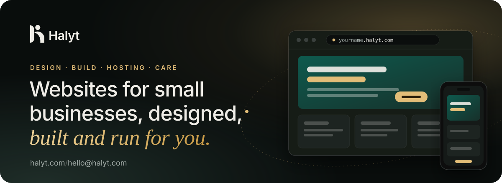
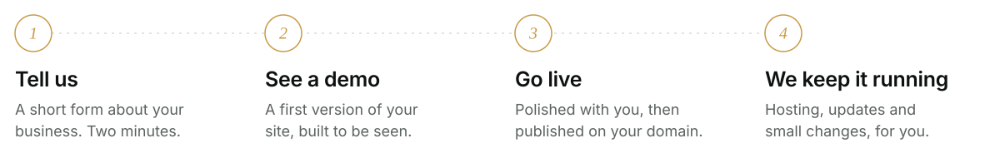

<a href="https://halyt.com">
  <picture>
    <source media="(prefers-color-scheme: dark)" srcset="https://raw.githubusercontent.com/halyt-team/halyt-team/main/assets/banner-dark.svg">
    
  </picture>
</a>

  <a href="https://halyt.com"><b>halyt.com</b></a>
  &nbsp;&middot;&nbsp;
  <a href="https://halyt.com/services/">Services</a>
  &nbsp;&middot;&nbsp;
  <a href="https://halyt.com/work/">Our work</a>
  &nbsp;&middot;&nbsp;
  <a href="https://halyt.com/pricing/">Pricing</a>
  &nbsp;&middot;&nbsp;
  <a href="https://halyt.com/get-started/"><b>Get started &rarr;</b></a>

 

### About Halyt

Halyt is a small team that designs, builds and runs websites for people and small businesses: nail salons, hair salons, barber shops, restaurants, homestays, pharmacies, clinics and growing companies.

We usually show you a working demo **before** you pay anything. After launch we stay on as your technical team, so you never have to think about hosting, domains or updates.

<table>
  <tr>
    <td width="50%" valign="top">
      <h4>Static website</h4>
      SHOW WHO YOU ARE
      
A landing page or a few pages: services, prices or menu, photos, map, contact. Very fast and very low maintenance.

      <ul>
        <li>Free subdomain like <code>yourname.halyt.com</code></li>
        <li>Mobile-first and SEO-ready</li>
        <li>Multilingual on request</li>
      </ul>
    </td>
    <td width="50%" valign="top">
      <h4>Dynamic website</h4>
      LET IT WORK FOR YOU
      
Bookings, an admin panel and data you can edit yourself. For businesses that need more than a brochure.

      <ul>
        <li>Online booking and forms</li>
        <li>Admin panel to update content</li>
        <li>Customer data stored safely</li>
      </ul>
    </td>
  </tr>
</table>

 

### How we work

<picture>
  <source media="(prefers-color-scheme: dark)" srcset="https://raw.githubusercontent.com/halyt-team/halyt-team/main/assets/process-dark.svg">
  
</picture>

<table>
  <tr>
    <td align="center" width="25%"><h3>48h</h3>to a first demo</td>
    <td align="center" width="25%"><h3>$0</h3>for your halyt.com subdomain</td>
    <td align="center" width="25%"><h3>7</h3>languages we build in</td>
    <td align="center" width="25%"><h3>1</h3>team from design to hosting</td>
  </tr>
</table>

 

### What lives here

Every other repository on this account is one client website, kept, versioned and maintained by Halyt.

<table>
  <tr><td><b>One repo per client</b></td><td>Named after the site: <code>&lt;business-name&gt;</code></td></tr>
  <tr><td><b>Live at</b></td><td><code>&lt;business-name&gt;.halyt.com</code> or the client's own domain</td></tr>
  <tr><td><b>Hosted on</b></td><td>Cloudflare Pages, with HTTPS and a global CDN</td></tr>
  <tr><td><b>Quality bar</b></td><td>Mobile-first, fast, accessible, SEO-ready, multilingual</td></tr>
</table>

  
  
  
  
  

<b>Tiếng Việt</b>

 

**Halyt** là đội ngũ thiết kế, lập trình và vận hành website cho cá nhân và doanh nghiệp nhỏ: tiệm nail, salon tóc, barber shop, nhà hàng, quán nhậu, homestay, nhà thuốc, phòng khám, công ty.

- **Demo trước:** bạn xem website thật trước khi trả bất kỳ khoản nào.
- **Làm trọn gói:** thiết kế, lập trình, tên miền, hosting và cập nhật. Một đội ngũ, một đầu mối.
- **Dễ được tìm thấy:** code sạch, trang tải nhanh, SEO chuẩn ngay từ đầu, bằng ngôn ngữ khách hàng của bạn dùng.

Mỗi repository khác trên tài khoản này là website của một khách hàng, chạy trên `ten-cua-ban.halyt.com` hoặc tên miền riêng.

Liên hệ: [halyt.com/vi/get-started](https://halyt.com/vi/get-started/) &middot; [hello@halyt.com](mailto:hello@halyt.com)

 

### Get in touch

Need a website for your business? Tell us about it at **[halyt.com/get-started](https://halyt.com/get-started/)** or write to **[hello@halyt.com](mailto:hello@halyt.com)**. We often reply with a demo of your future site.

  
  
  
  
  

&copy; Halyt &middot; Websites designed, built and run for small businesses.
